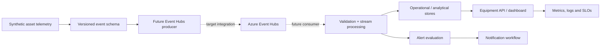

<div align="center">


### Telemetry contracts · Event-driven processing · Equipment reliability signals

[](https://learn.microsoft.com/azure/event-hubs/)
[](https://www.python.org/)
[](https://github.com/haqueamir70-coder/azure-industrial-iot-reliability-platform/actions/workflows/ci.yml)
[](#-safety-and-data-boundary)

**A synthetic-data reference platform for modelling telemetry ingestion and reliability workflows for rotating industrial assets such as motors and pumps.**

[Architecture](#-target-architecture) · [Run simulator](#-run-the-simulator) · [Event contract](#-telemetry-contract) · [Operations](#-reliability-and-operations)

</div>

> [!CAUTION]
> **Safety and confidentiality boundary:** this is an independent portfolio lab using generated data only. It is not connected to a refinery, customer system, OT network, PLC, safety-instrumented system or real equipment. Demo anomaly thresholds are illustrative software examples — not certified alarm limits, maintenance advice or safety controls. Never send control commands to industrial equipment from this project.

## The engineering problem

Rotating equipment produces time-series signals such as temperature, vibration, speed and current. A reliability application needs a consistent event contract, resilient ingestion, replay/deduplication behavior, clear alert ownership and operational visibility.

This project starts with a deterministic simulator and a versioned telemetry schema. Azure Event Hubs and downstream cloud services are documented as a target integration path, not claimed as deployed services.

## Target architecture

<p align="center">
  
</p>



## Implemented today

| Capability | Evidence in repository |
|---|---|
| Event contract | Versioned JSON Schema at `schemas/telemetry-event.schema.json` |
| Synthetic telemetry | Python simulator emits JSON Lines |
| Deterministic tests | Event shape, parameter validation and anomaly injection tests |
| CI | Documentation checks, secret scanning, Python compilation and unit tests |
| Cloud design | Event Hubs, processing, storage, API, alerts and observability architecture |
| Operations | Consumer lag, quarantine, alert delivery and SLO guidance |

## Run the simulator

Requirements: Python 3.12+; no third-party packages required.

### Run tests

```bash
python -m unittest discover -s tests -v
```

### Generate sample telemetry

```bash
python -m src.telemetry_simulator --events 12 --assets 3 --seed 42
```

### Inject a synthetic anomaly pattern

```bash
python -m src.telemetry_simulator --events 20 --assets 4 --anomaly-every 5 > telemetry.jsonl
```

The output is synthetic JSON Lines. Validate against the JSON Schema with a Draft 2020-12-compatible validator before using it in downstream experiments.

## Telemetry contract

Each event carries:

| Field | Meaning |
|---|---|
| `event_id` | Unique event identifier for deduplication |
| `schema_version` | Explicit contract version |
| `site_id` / `asset_id` | Synthetic site and equipment identifiers |
| `event_time` | Timezone-aware UTC timestamp |
| `measurements` | Temperature (°C), vibration velocity (mm/s), speed (rpm) and current (A) |

- [JSON Schema](schemas/telemetry-event.schema.json)
- [Telemetry contract notes](docs/telemetry-contract.md)

## Reliability engineering considerations

The target operating model covers:

- Event validation and schema evolution.
- Idempotent processing and duplicate detection.
- Consumer lag, checkpoint age and replay.
- Poison-event quarantine / dead-letter handling.
- Alert deduplication, ownership and delivery retries.
- Data completeness, end-to-end latency and service-level objectives.

Example thresholds and SLOs must be derived from validated equipment/vendor requirements and business risk before any real operational use.

## Safety and data boundary

- No customer or refinery data is present.
- No OT network, PLC, control system or safety-instrumented system is connected.
- No equipment-control capability is implemented.
- Do not upload customer telemetry, site identifiers, connection strings or credentials.
- Keep IT analytics separate from OT control and safety functions.
- Treat synthetic anomalies as software test cases only.

## Roadmap

- [x] Versioned telemetry contract and JSON Schema
- [x] Deterministic synthetic telemetry simulator
- [x] Unit tests and GitHub Actions quality checks
- [x] Target Azure architecture and operations documentation
- [ ] Event Hubs producer/consumer adapters using managed identity
- [ ] Schema validation, checkpointing and quarantine flow
- [ ] Equipment-state API and dashboard
- [ ] Terraform private Azure foundation and scoped workload identity
- [ ] Load tests, alert-routing tests and genuine runtime evidence

## Repository map

```text
src/                 Synthetic telemetry simulator
schemas/             Versioned JSON Schema
tests/               Deterministic unit tests
architecture/        Azure target architecture and decisions
docs/                Contract, security and operations
interview-prep/      Senior engineering scenarios
.github/workflows/   CI validation
```

## Further reading

- [Reliability and operations](docs/reliability-operations.md)
- [Security model](docs/security-model.md)
- [Architecture decisions](architecture/decisions/README.md)
- [Senior interview preparation](interview-prep/README.md)

## Maintainer

**MD Amirul Haque** · [GitHub](https://github.com/haqueamir70-coder) · [LinkedIn](https://www.linkedin.com/in/md-amirul-haque/)

<sub>Reliable telemetry begins with a trustworthy contract and an honest operating boundary.</sub>
