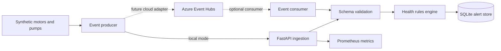

# Azure Industrial IoT Reliability Platform

  

A portfolio-grade reference implementation for synthetic industrial telemetry ingestion and equipment-health alerting. It builds on the existing event-contract and simulator lab with a runnable API and local alert processing service.

> **Safety and confidentiality:** Independent learning project only. No customer telemetry, refinery identifiers, proprietary schemas, credentials or control functions. This is read-only analytics and alert simulation—not a safety instrumented system. Example thresholds are illustrative and must never be used to operate or protect real equipment.

## Architecture


## Added application capabilities
- Pydantic telemetry contract with bounded numeric fields and timezone-aware timestamps.
- FastAPI health, asset, telemetry-ingestion, alert-list and metrics endpoints.
- Configurable demo warning/critical rules for temperature and vibration.
- SQLite alert persistence with unique event ID constraint to prevent duplicate alert records.
- Docker Compose with non-root image, read-only root filesystem, dropped capabilities and no-new-privileges.
- CI quality/security workflow using pytest, Ruff, Bandit and dependency audit.

## Run locally
Requirements: Python 3.12+ and Docker Compose.
```bash
docker compose up --build
```
Open `http://localhost:8000/docs`. Check:
```bash
curl http://localhost:8000/healthz
curl http://localhost:8000/api/v1/assets
curl http://localhost:8000/metrics
```
Send synthetic telemetry:
```bash
curl -X POST http://localhost:8000/api/v1/telemetry \\
  -H 'Content-Type: application/json' \\
  -d '{"event_id":"demo-01","asset_id":"PUMP-DEMO-01","asset_type":"pump","temperature_c":92,"vibration_mm_s":8.2,"timestamp":"2026-11-12T08:00:00Z"}'
curl http://localhost:8000/api/v1/alerts
```

Run tests:
```bash
python -m venv .venv && source .venv/bin/activate
pip install -e '.[dev]'
ruff check .
pytest -q
```

## Azure integration roadmap
The existing repository documents Event Hubs architecture, contracts and operational considerations. The next cloud stage is an adapter using a dedicated managed identity and the narrowest Event Hubs Data Receiver role, plus durable checkpoint/idempotency and poison-message quarantine. Keep cloud infrastructure in a disposable non-production subscription, inspect Terraform plans and costs before apply, and never commit credentials. No cloud deployment is claimed.

## Key senior interview topics
Event Hubs consumer groups, at-least-once delivery, idempotency, schema evolution, consumer lag, backpressure, retry/DLQ, managed identity, private endpoints, observability, SLI/SLOs, alert deduplication and incident runbooks.

## Implementation boundary
The local API and synthetic event path are the runnable baseline. A production-grade implementation still needs durable idempotency across restarts, explicit DLQ/quarantine, retry classification, graceful shutdown, load tests, security review, alert delivery integration and measured SLO evidence. Do not connect this demo to OT networks or live equipment.
