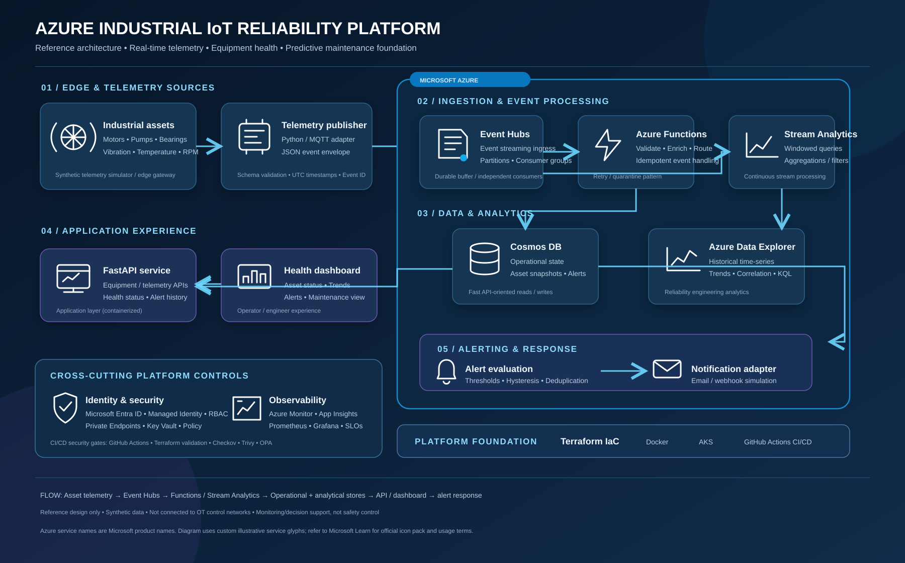
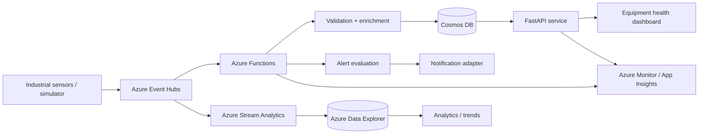

# Azure Industrial IoT Reliability Platform


A production-inspired reference implementation for collecting industrial equipment telemetry, detecting abnormal operating conditions, and surfacing reliability insights for motors, pumps, and other rotating assets.

> **Scope and safety:** This is an independent learning/demo platform using synthetic telemetry. It is not connected to any real refinery, customer environment, safety-instrumented system, or operational control network. Anomaly scores are advisory and must never replace certified protection systems or engineer judgement.

## Why this project

Unexpected motor and pump failures can create costly downtime. This platform demonstrates an event-driven Azure architecture that can ingest equipment telemetry, process it in near real time, persist operational and analytical data, and provide an API/dashboard for equipment health and alerts.

## Reference architecture



[Open full-size Azure architecture diagram](architecture/azure-industrial-iot-architecture.svg)

The visual uses Azure service tiles and labelled flows to show ingestion, processing, data, application, alerting, identity and observability layers. An editable Mermaid flow is also maintained below.



## Architecture at a glance

| Layer | Responsibility | Candidate technology |
|---|---|---|
| Device / simulation | Publish timestamped vibration, temperature, speed and current | Python simulator |
| Ingestion | Durable event ingress and partitioned streams | Azure Event Hubs |
| Stream processing | Filtering, windowing, aggregations and routing | Azure Stream Analytics / Functions |
| Operational store | Latest equipment state and alerts | Azure Cosmos DB |
| Analytical store | Historical telemetry exploration | Azure Data Explorer |
| Application | REST APIs and equipment health views | Python FastAPI + dashboard |
| Platform | Repeatable infrastructure and workload deployment | Terraform, Docker, AKS |
| Security / operations | Identity, policy, scans, logs, metrics and alerts | Entra ID, Managed Identity, Checkov, Trivy, Prometheus, Grafana, Azure Monitor |

The diagram is a target design. Components will be implemented incrementally; their presence here does not mean cloud resources have already been deployed.

## Repository roadmap

- [x] Repository initialized and architecture blueprint documented
- [x] Senior-level interview handbook foundation
- [ ] Synthetic telemetry simulator and event schema
- [ ] FastAPI equipment and telemetry API
- [ ] Rule-based anomaly and alert engine
- [ ] Unit and integration tests
- [ ] Docker Compose local environment
- [ ] Terraform modules and secure Azure baseline
- [ ] Event Hubs ingestion and processing adapters
- [ ] AKS manifests and deployment workflow
- [ ] DevSecOps gates: lint, tests, Checkov, Trivy and policy checks
- [ ] Observability: metrics, logs, dashboards and SLO examples

## Proposed project layout

```text
.
├── architecture/          # diagrams, data flows and ADRs
├── docs/                  # design, setup, operations and security
├── interview-prep/        # senior-level interview Q&A
├── src/
│   ├── telemetry-api/     # FastAPI application
│   ├── processor/         # event validation and processing
│   └── alert-engine/      # thresholds, severity and deduplication
├── simulator/              # synthetic motor and pump telemetry
├── tests/                  # unit and integration tests
├── terraform/              # reusable Azure infrastructure
├── docker/                 # container build assets
├── kubernetes/             # AKS manifests
├── monitoring/             # Prometheus, Grafana and alert rules
├── security/               # IaC and container security policies
└── .github/workflows/      # CI and security automation
```

## Example telemetry contract

Use a stable event identifier, asset identifier, UTC timestamp, schema version, numeric measurements and documented units.

```json
{
  "event_id": "evt-000001",
  "schema_version": "1.0",
  "asset_id": "pump-plant-a-001",
  "site_id": "site-demo-a",
  "event_time": "2026-01-15T10:15:30Z",
  "measurements": {
    "temperature_c": 72.4,
    "vibration_mm_s": 4.8,
    "rpm": 1480,
    "current_amp": 18.2
  }
}
```

These readings are synthetic examples, not engineering alarm limits.

## Reliability principles demonstrated

- **At-least-once delivery:** consumers tolerate redelivery.
- **Idempotency:** deduplicate by event identifier or a documented idempotency key.
- **Partitioning:** choose a key that preserves per-asset ordering where needed; avoid hot partitions.
- **Back-pressure:** scale consumers based on lag and processing capacity.
- **Resilience:** bounded retries, exponential backoff, quarantine/dead-letter handling and replay.
- **Security:** managed identities, least-privilege RBAC, private connectivity where appropriate and auditable changes.
- **Observability:** track ingestion rate, consumer lag, processing failures, alert latency, API latency and SLOs.
- **Safety boundary:** monitoring/decision support only, not machine control or emergency shutdown.

## Local development

The application components are being added in phases. At this stage this repository is an architecture and engineering blueprint, not a ready-to-run product.

```bash
git clone https://github.com/haqueamir70-coder/azure-industrial-iot-reliability-platform.git
cd azure-industrial-iot-reliability-platform
```

Python environment instructions will be added with the first application source.

## Documentation

- [Architecture overview](architecture/README.md)
- [Architecture decisions](architecture/decisions/README.md)
- [Telemetry contract](docs/telemetry-contract.md)
- [Security model](docs/security-model.md)
- [Reliability and operations](docs/reliability-operations.md)
- [Interview preparation handbook](interview-prep/README.md)

## Disclaimer

All sites, assets, readings and incidents in this repository are fictional. Do not commit credentials, customer data, real infrastructure identifiers or proprietary architecture.
