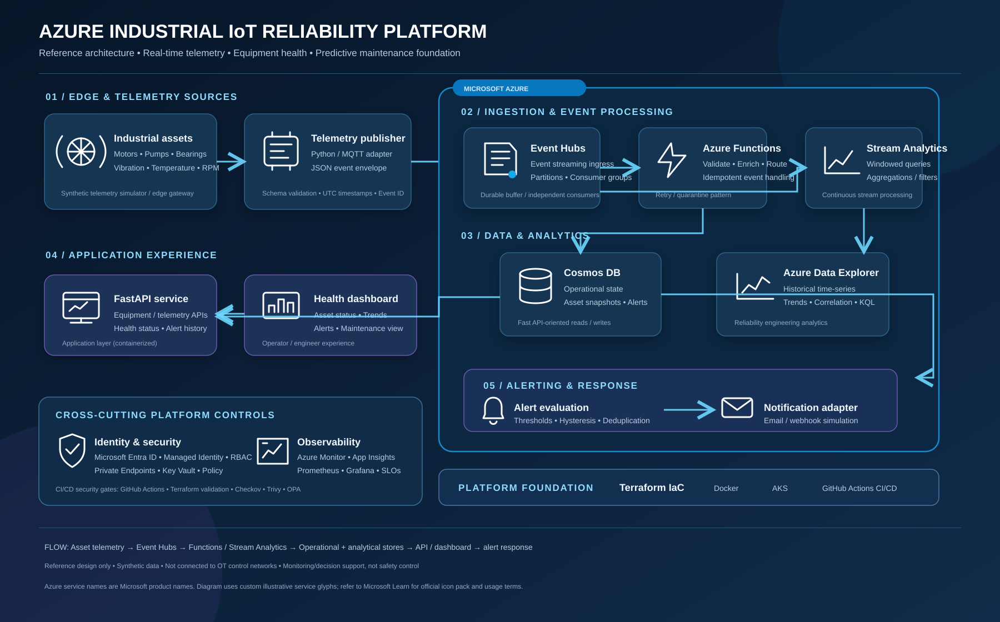
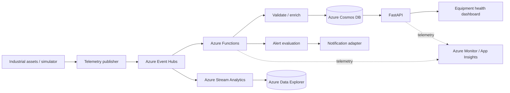

# Azure Industrial IoT — Architecture

## Premium architecture diagram

[View SVG diagram](azure-industrial-iot-architecture.svg)

The diagram is organised into six layers: edge telemetry, event ingestion, stream processing, operational/analytical data, application/alerting, and cross-cutting security/observability.

## End-to-end flow

1. Synthetic motor and pump telemetry is generated with stable asset IDs, UTC timestamps and versioned event envelopes.
2. A publisher sends events to Azure Event Hubs.
3. Azure Functions validates, enriches and routes operational events; Azure Stream Analytics performs windowed stream queries.
4. Cosmos DB stores current equipment state and alert records. Azure Data Explorer stores historical time-series data.
5. FastAPI exposes equipment, telemetry and alert APIs; a dashboard presents health and trends.
6. Alert evaluation applies configurable thresholds, hysteresis and deduplication before a notification adapter.
7. Microsoft Entra ID, managed identities, RBAC, private networking, Azure Monitor and application observability provide cross-cutting controls.

## Editable logical flow

## Component responsibilities

| Component | Role |
|---|---|
| Event Hubs | Durable event ingress, partitioning and consumer groups |
| Azure Functions | Code-based validation, enrichment, routing and idempotent writes |
| Stream Analytics | Event-time windows, filtering and continuous aggregations |
| Cosmos DB | Operational asset state and alert records |
| Azure Data Explorer | Historical telemetry and reliability analytics |
| FastAPI | Equipment, telemetry, health and alert APIs |
| Dashboard | Asset health, trends and alert review |
| Entra ID / Managed Identity | Workload authentication without embedded secrets |
| Azure Monitor / App Insights | Platform and application telemetry |

## Design notes

- Event delivery is treated as at-least-once; side effects must be idempotent.
- Partition keys should be selected around per-asset ordering and distribution.
- Operational and analytical queries use separate stores.
- Retry is bounded; poison events are quarantined and replayed deliberately.
- The platform is monitoring/decision support only, not machine control or emergency shutdown.
- All data in the demo is synthetic. No real customer, refinery or OT environment is represented.
