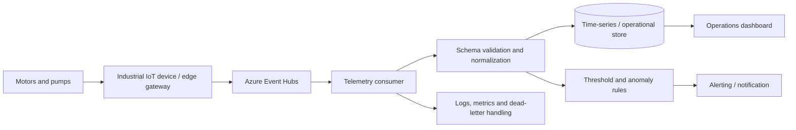

# Azure industrial IoT reliability platform — Architecture & Interview Guide

Synthetic telemetry reference from rotating equipment to Event Hubs, processing, storage, dashboards and alerting. No customer or refinery telemetry is included; validate real OT integration separately.

## Architecture diagram

## Interview questions

1. 1. Why use Event Hubs for industrial telemetry ingestion?
2. 2. How do partitions and consumer groups affect throughput and parallelism?
3. 3. How do you preserve event ordering for one equipment asset?
4. 4. How do you validate telemetry schemas and handle schema evolution?
5. 5. How do you handle duplicate, delayed and out-of-order events?
6. 6. What is the difference between threshold alerting and anomaly detection?
7. 7. How would you design retry, checkpointing and dead-letter handling?
8. 8. How do you secure device-to-cloud ingestion and managed identities?
9. 9. Which SLI/SLOs matter for telemetry freshness and alert latency?
10. 10. How would you demonstrate the system using synthetic data without exposing customer OT data?

## Interview preparation note
For every answer, explain the architecture, trust boundary, failure mode, telemetry, cost implication and validation evidence. Distinguish implemented, CI-validated, cloud-deployed and planned capabilities.
