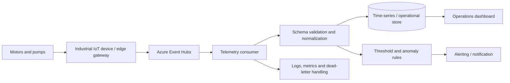

# Azure industrial IoT reliability platform — Architecture & Interview Guide

Synthetic telemetry reference from rotating equipment to Event Hubs, processing, storage, dashboards and alerting. No customer or refinery telemetry is included; validate real OT integration separately.

## Architecture diagram

## Interview questions

1. 1. Why use Event Hubs for industrial telemetry ingestion?
2. 2. How do partitions and consumer groups affect throughput and parallelism?
3. 3. How do you preserve event ordering for one equipment asset?
4. 4. How do you validate telemetry schemas and handle schema evolution?
5. 5. How do you handle duplicate, delayed and out-of-order events?
6. 6. What is the difference between threshold alerting and anomaly detection?
7. 7. How would you design retry, checkpointing and dead-letter handling?
8. 8. How do you secure device-to-cloud ingestion and managed identities?
9. 9. Which SLI/SLOs matter for telemetry freshness and alert latency?
10. 10. How would you demonstrate the system using synthetic data without exposing customer OT data?

## Interview preparation note
For every answer, explain the architecture, trust boundary, failure mode, telemetry, cost implication and validation evidence. Distinguish implemented, CI-validated, cloud-deployed and planned capabilities.

## Interview questions — suggested answers

### 1. Answer

Event Hubs is a managed high-throughput event ingestion service suited to streaming telemetry from many devices. It decouples producers from downstream consumers.

### 2. Answer

Partitions enable parallel processing; consumer groups provide independent views of the stream. Partition count and key choice affect ordering and throughput.

### 3. Answer

Partition by stable equipment/device ID so events for one asset land in one partition, preserving partition order. Global ordering across partitions is not guaranteed.

### 4. Answer

Validate each event against a versioned schema, reject or quarantine invalid payloads, track schema versions and support backward-compatible evolution.

### 5. Answer

Use event IDs/idempotent processing, timestamps and sequence metadata. Handle late data with event-time windows and deduplicate retries at the consumer/store.

### 6. Answer

Threshold alerts detect known limits; anomaly detection identifies deviations from learned behavior. Combine both with equipment context and alert suppression.

### 7. Answer

Checkpoint only after durable processing, retry transient failures with backoff, route poison events to a dead-letter path and alert on growing lag.

### 8. Answer

Use device identity/certificates and secure provisioning, TLS, scoped Event Hubs permissions, managed identity for consumers and private networking where supported.

### 9. Answer

Measure telemetry freshness, ingestion success, consumer lag, alert generation latency and notification delivery. Define SLOs based on operational risk.

### 10. Answer

The repository contains synthetic data and tests. Real deployment requires OT/network assessment, device identity, data governance, safety approval and validation with representative non-sensitive telemetry.

## Complete zero-to-hero guide

See [ZERO-TO-HERO.md](./ZERO-TO-HERO.md) for the business scenario, architecture walkthrough, tool-by-tool explanations, implementation sequence, practical commands, troubleshooting playbook and additional scenario-based interview questions with answers.
